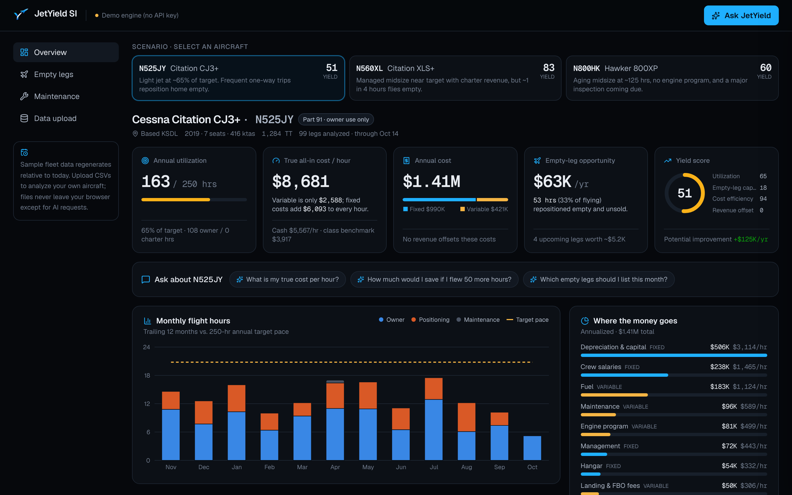
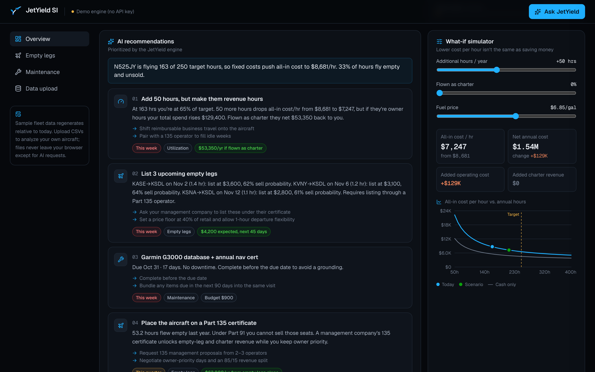
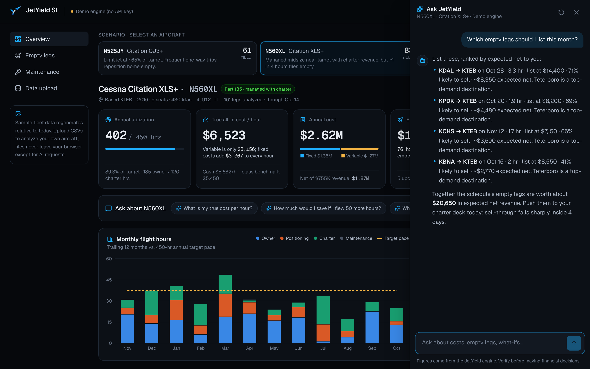

# JetYield AI

**Your jet costs more per hour than you think. JetYield finds the money.**

JetYield AI is an AI-native yield optimization tool for private aircraft owners and small operators. It shows the true all-in cost per hour, prices the empty legs an aircraft is already flying, and turns flight, cost and maintenance data into prioritized actions that lower the cost of ownership.



> Demo MVP. All aircraft, tail numbers and figures are fictional sample data.

## Why

Private jets have high fixed costs and low utilization: often 150–300 hours a year. That combination produces three blind spots this demo targets:

1. **Owners underestimate their cost per hour.** Operators quote the variable rate (fuel, reserves, fees). Fixed costs, depreciation and cost of capital often double or triple it.
2. **Empty legs fly empty.** One-way trips force repositioning legs that could be sold, but usually aren't.
3. **"Fly more to lower your cost per hour" is half true.** More hours spread fixed cost thinner, but total spend rises unless those hours earn revenue. JetYield makes that trade-off explicit.

## What's in the demo

| | |
|---|---|
| **Dashboard** | Utilization vs. target, true all-in and cash cost per hour, fixed vs. variable spend, empty-leg opportunity, and a 0–100 Yield Score with dollar improvement potential. |
| **Scenario switcher** | Three preloaded aircraft with different economics: an under-flown **Citation CJ3+** (Part 91), a managed **Citation XLS+** flying charter (Part 135), and an aging **Hawker 800XP** with a major inspection due and no engine program. |
| **AI recommendations** | Prioritized actions across empty legs, utilization, cost and maintenance, each with a dollar impact. |
| **Ask JetYield** | A chat agent that answers questions like *"How much would I save if I flew 50 more hours?"* by running the scenario through the cost engine. |
| **What-if simulator** | Sliders for added hours, charter share and fuel price, with a live cost-per-hour curve. |
| **Empty legs** | Upcoming repositioning legs priced from route demand, seasonality and lead time, ranked by expected net to the owner, with copy-ready listing text. |
| **Maintenance timing** | Hour- and calendar-based items projected from the current flying pace, with conflicts against scheduled trips. |
| **CSV upload** | Flight logs, cost ledgers and maintenance tracking, validated row by row with clear errors, then analyzed instantly. |

<p>
  
  
</p>

## How the AI is designed

The design rule is simple: **the engine does the math, the model does the judgment.**

- `src/lib/engine/` is a deterministic TypeScript cost engine. Every number on screen, and every number the model is allowed to quote, comes from here.
- **Recommendations:** the engine generates candidate recommendations with computed dollar impact. Claude receives the aircraft's structured data plus those candidates, then re-ranks, rewrites and explains them, returning JSON via structured outputs. Impact figures are merged back from the engine by id, so the model cannot invent a number, and any recommendation id it makes up is dropped.
- **Chat agent:** Claude gets the aircraft snapshot (cached with prompt caching across turns) and two tools: `run_scenario` (what-if on hours, charter share and fuel price) and `get_flight_log` (leg-level detail). Responses stream to the browser as newline-delimited JSON, with tool activity shown inline.
- **Cached recommendations:** results are cached server-side for 24 hours, keyed by a hash of the dataset (`src/lib/ai/recommend-cache.ts`). Sample aircraft are identical for every visitor on a given day, so the public demo makes at most one recommendation call per aircraft per day; concurrent misses share one call, and failures are never cached.
- **Never breaks on stage:** without an `ANTHROPIC_API_KEY` the app runs in **demo mode**, where the same engine answers the common questions and produces recommendations. If the API errors or times out, both routes fall back to the engine automatically.
- **Swappable provider:** everything model-specific lives behind the `YieldAdvisor` interface in `src/lib/ai/types.ts`. Implement it and return your provider from `src/lib/ai/index.ts`.

Defaults: model `claude-opus-5-5` (override with `ANTHROPIC_MODEL`), low effort for chat latency, medium effort for recommendations, and server-side refusal fallbacks enabled.

## Methodology

| Metric | Definition |
|---|---|
| Annualized hours | Block hours in the trailing 12 months, scaled up if the log covers less than a year. |
| All-in cost / hr | (Fixed + variable costs, annualized) ÷ annualized hours. Includes depreciation and cost of capital. |
| Cash cost / hr | All-in cost excluding depreciation and cost of capital. |
| Fixed vs. variable | Fixed costs are annualized over the ledger's calendar coverage; variable costs scale with hours flown. |
| Empty-leg price | Retail charter rate × block hours × 40–65%, scaled by destination demand and seasonality. |
| Expected net | (List price × 85% owner share − ~$450 handling and catering) × sell probability. Fuel and crew aren't incremental because the leg flies anyway. |
| Yield Score | Weighted: utilization vs. target (35%), empty-leg capture (25%), cost efficiency vs. class benchmark (25%), revenue offset of fixed costs (15%). |

Benchmarks and market rates in `src/lib/data/fleet.ts` are illustrative assumptions for the demo, not market data.

## Getting started

Requires Node.js 20.9+.

```bash
npm install
cp .env.example .env.local   # optional: add ANTHROPIC_API_KEY for the live Claude agent
npm run dev                  # http://localhost:3000
```

| Variable | Required | Purpose |
|---|---|---|
| `ANTHROPIC_API_KEY` | No | Enables the Claude agent. Without it the app runs in demo mode. |
| `ANTHROPIC_MODEL` | No | Model override. Defaults to `claude-opus-5-5`. |
| `AI_RATE_LIMIT_PER_MINUTE` | No | Per-IP limit on the AI routes. Defaults to 20. |

```bash
npm test           # engine, CSV validation and demo-advisor tests (Vitest)
npm run lint
npm run typecheck
npm run build
```

### Deploying

The app is a standard Next.js project and deploys to Vercel with zero configuration. Set `ANTHROPIC_API_KEY` in the project's environment variables to enable the live agent. The AI routes are rate limited per IP in memory, which suits a single-instance demo; use a shared store before scaling out.

## CSV formats

Download a sample of each file from the **Data upload** page, edit it, and upload it back. Headers are case-insensitive.

**Flight log:** `date`, `from`, `to`, `block_hours`, `purpose` (`owner` | `charter` | `positioning` | `maintenance`), optional `passengers`, `revenue`, `fuel_gallons`. Positioning legs with 0 passengers count as empty. Future-dated legs become the schedule used for empty-leg planning.

**Cost ledger:** `date`, `category`, `amount`, optional `kind` (`fixed` | `variable`, inferred from category), `description`, `gallons`. Categories: `crew`, `hangar`, `insurance`, `training`, `management`, `subscriptions`, `capital`, `fuel`, `maintenance`, `engine_reserve`, `fees`, `crew_travel`, `other`.

**Maintenance:** `item`, `due_hours` and/or `due_date`, optional `estimated_cost`, `downtime_days`, `notes`.

Uploaded files are parsed in the browser and kept in local storage. They're sent to the server only as part of AI requests and are not stored there. If you upload a flight log without a cost ledger, variable costs are modeled from your legs using the aircraft type's cost assumptions.

## Project structure

```
src/
  app/
    page.tsx                  Landing page
    dashboard/                Overview, empty legs, maintenance, data upload
    api/chat/                 Streaming chat agent (NDJSON)
    api/recommendations/      AI-prioritized recommendations
  components/                 Dashboard UI, charts, chat drawer
  lib/
    engine/                   Deterministic cost, empty-leg, maintenance and scenario engine
    ai/                       Provider interface, Claude implementation, demo fallback, prompts, tools
    data/                     Sample fleet, airport directory, seeded data generator
    csv.ts                    CSV specs, parsing and validation
    schema.ts                 Zod validation for API payloads
```

## Not in this MVP

- **Authentication.** The demo is deliberately login-free. Accounts (email/password or magic link) only matter once data is stored server-side, and the natural next step is Auth.js or Supabase Auth together with a database for fleets and uploads.
- **Live market data.** Charter rates, fuel prices and route demand are static assumptions. Production would pull from charter marketplaces, fuel contract feeds and flight tracking.
- **Regulatory review.** Part 91 vs. Part 135 notes are simplified. Anything involving selling seats or legs needs an operator and legal review.

## License

[MIT](LICENSE)
